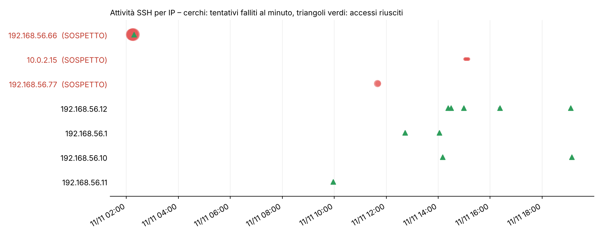
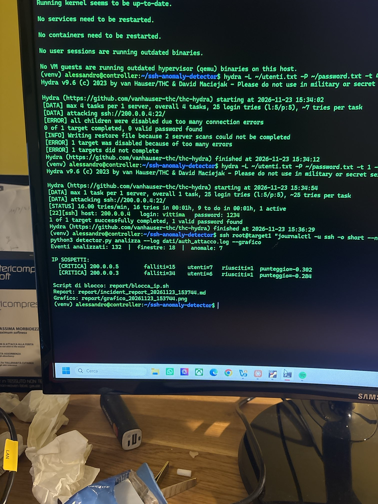

# SSH Anomaly Detector

Rilevamento di attacchi SSH con il **machine learning**: un modello **Isolation Forest** impara com'è il traffico SSH normale di un server Linux e segnala gli accessi anomali (brute force, password spraying, scansioni). Per ogni attacco genera un **Incident Report** e uno **script iptables** per bloccare gli IP sospetti.

Il progetto è pensato per un laboratorio VirtualBox con server Ubuntu, firewall iptables e una VM attaccante con Hydra e Nmap ([guida](GUIDA_LAB.md)).



## Il problema

Un server SSH esposto riceve continuamente tentativi di accesso automatici. Le regole fisse (per esempio "blocca dopo 5 errori") non vedono gli attacchi lenti e sono rigide. Questo progetto usa un approccio diverso: invece di regole scritte a mano, **il modello impara il comportamento normale** e segnala tutto ciò che se ne discosta.

## Come funziona

```
 /var/log/auth.log ──► 1. Parsing ──► 2. Feature per IP ──► 3. Isolation Forest ──► 4. Report + blocco
                        eventi SSH      ogni 5 minuti          punteggio anomalia       iptables
```

1. **Parsing dei log.** Legge `auth.log` (formato classico e formato ISO di Ubuntu 24.04, anche le righe compattate `message repeated N times`) e riconosce accessi riusciti, password errate, utenti inesistenti e connessioni chiuse prima del login.
2. **Feature engineering.** Per ogni IP e ogni finestra di 5 minuti calcola 8 indicatori: tentativi falliti, utenti inesistenti, connessioni chiuse prima del login, accessi riusciti, nomi utente diversi provati, eventi al minuto, percentuale di fallimenti e attività fuori orario.
3. **Machine learning.** Un modello **Isolation Forest** (scikit-learn), addestrato solo su log normali, assegna a ogni finestra un punteggio di anomalia. Non servono esempi di attacchi per addestrarlo: è un approccio *non supervisionato*. Un filtro anti-rumore evita di segnalare chi sbaglia la password una volta sola.
4. **Risposta.** Per ogni IP sospetto il programma:
   - assegna una **gravità** (CRITICA se dopo i tentativi falliti c'è un accesso riuscito, cioè una possibile compromissione);
   - **spiega perché** è anomalo, confrontando i valori con quelli normali ("160 tentativi falliti in 5 minuti, massimo normale: 2");
   - scrive un **Incident Report** in Markdown con cronologia, utenti provati e azioni consigliate ([esempio](docs/esempio_incident_report.md));
   - genera lo script **`blocca_ip.sh`** con le regole iptables, applicabile anche in automatico con `--applica`.

## Risultati sui log simulati

Addestrato su 21 giorni di traffico normale e testato su una giornata con tre attacchi simulati (`genera_log_test.py`):

| Attacco | Sorgente | Rilevato | Gravità |
| --- | --- | --- | --- |
| Brute force veloce (Hydra, ~150 tentativi/minuto) con accesso riuscito finale | 192.168.56.66 | Sì | CRITICA |
| Password spraying lento (25 utenti, 1 tentativo ogni 15-30 s) | 10.0.2.15 | Sì | ALTA |
| Scansione della porta 22 (connessioni senza login) | 192.168.56.77 | Sì | MEDIA |
| Utenti legittimi, anche con qualche errore di password | 192.168.56.x | Nessun falso allarme | – |

## Risultati nel laboratorio reale

Il detector è stato poi provato su un laboratorio di VM VirtualBox vere: un server Ubuntu bersaglio (target1), una macchina che genera gli attacchi (target2) e un nodo che esegue il detector, analizzando i log del bersaglio. Il modello è stato addestrato sul traffico SSH normale del server e poi messo alla prova con due attacchi reali, uno fatto a mano con `ssh` e uno con **Hydra**.



| Attacco | Sorgente | Tentativi falliti | Utenti provati | Accesso riuscito | Gravità |
| --- | --- | --- | --- | --- | --- |
| Brute force manuale + compromissione | 200.0.0.5 | 15 | 7 | sì | CRITICA |
| Brute force con Hydra + compromissione | 200.0.0.3 | 34 | 6 | sì | CRITICA |
| Traffico amministrativo normale | 200.0.0.x | – | – | – | nessun falso allarme |

Entrambe le compromissioni sono state classificate CRITICA perché dopo i tentativi falliti è seguito un accesso riuscito all'utente debole `vittima`. Il report completo di questo test è in [docs/incident_report_lab.md](docs/incident_report_lab.md) e il grafico in [docs/grafico_lab.png](docs/grafico_lab.png). La procedura per riprodurlo è in [GUIDA_LAB.md](GUIDA_LAB.md).

## Installazione

```bash
git clone https://github.com/mattgrIT/ssh-anomaly-detector.git
cd ssh-anomaly-detector
python3 -m venv venv
source venv/bin/activate
pip install -r requirements.txt
```

## Uso

**Prova veloce con dati simulati:**

```bash
python3 genera_log_test.py                                   # crea dati/auth_normale.log e dati/auth_attacco.log
python3 detector.py addestra --log dati/auth_normale.log     # addestra il modello
python3 detector.py analizza --log dati/auth_attacco.log --grafico
```

**Su un server reale:**

```bash
sudo journalctl -u ssh --since "14 days ago" -o short > dati/auth_normale.log
python3 detector.py addestra --log dati/auth_normale.log
sudo cp /var/log/auth.log dati/auth_oggi.log && sudo chown $USER dati/auth_oggi.log
python3 detector.py analizza --log dati/auth_oggi.log --grafico --whitelist 192.168.56.1
sudo bash report/blocca_ip.sh                                # blocca gli IP sospetti
```

La guida completa per riprodurre il laboratorio con Hydra e Nmap è in [GUIDA_LAB.md](GUIDA_LAB.md).

### Opzioni principali

| Opzione | Significato |
| --- | --- |
| `--finestra 5` | durata della finestra di analisi in minuti (in `addestra`) |
| `--soglia 0` | sotto questo punteggio una finestra è anomala; più bassa = meno segnalazioni |
| `--min-eventi 3` | filtro anti-rumore: eventi sospetti minimi per segnalare una finestra |
| `--whitelist IP ...` | IP da non segnalare mai, per esempio il PC di amministrazione |
| `--grafico` | crea il grafico PNG dell'attività per IP |
| `--applica` | applica subito il blocco iptables (richiede root) |
| `--json` | stampa gli IP sospetti in JSON, per collegarlo ad altri strumenti |

## Struttura

```
ssh-anomaly-detector/
├── detector.py            # parsing, feature, modello, report e blocco
├── genera_log_test.py     # generatore di log simulati per i test
├── requirements.txt
├── GUIDA_LAB.md           # come riprodurre il laboratorio con Hydra e Nmap
└── docs/                  # grafico e Incident Report di esempio
```

## Limiti e sviluppi futuri

- Il modello è buono quanto i dati normali di addestramento: servono almeno una o due settimane di log senza attacchi.
- Analizza un server alla volta. Il passo successivo è raccogliere i log di più server in modo centralizzato (rsyslog o un SIEM come Wazuh) e analizzarli insieme.
- Esecuzione periodica con cron o systemd timer e notifica via email o Telegram.
- Confronto con altri modelli (Local Outlier Factor, One-Class SVM) e con fail2ban.

## Tecnologie

Python · scikit-learn (Isolation Forest) · pandas · matplotlib · Linux Ubuntu Server · OpenSSH · iptables · Hydra · Nmap · VirtualBox

## Autore

**Matteo Grossi** – Sistemista junior e Cybersecurity Analyst junior, Roma · [github.com/mattgrIT](https://github.com/mattgrIT)
